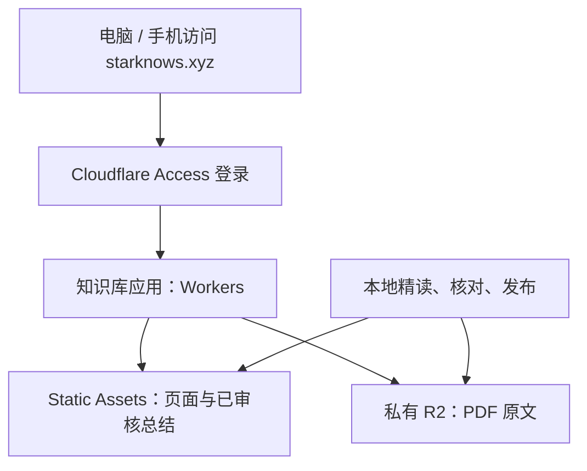

# StarKnows 知识库 Cloudflare 初步评估（历史参考）

**2026-10-26 已按调整后的免费方案上线：[starknows.xyz](https://starknows.xyz)。采用纯 Workers Static Assets，保留全部 174 份总结、上传 157 份原文，17 份超限文件显示“因文件过大，无云端存储，请回到本地源文件”。不启用 R2，当前为公开访问。部署命令、验证结果和最新状态见 [cloudflare/README.md](cloudflare/README.md)。以下为此前的容量评估与备选方案，不再作为执行配置。**

核验日期：2026-10-26。初步评估时尚未创建云端资源、上传原文或修改域名配置。

**建议采用：Workers Static Assets 托管页面，R2 Standard 保存 PDF，Cloudflare Access 控制访问。** 入口为 `https://starknows.xyz`。继续在本地完成报告精读与总结，审核完成后增量同步到线上。当前这批 PDF 的容量可以落在 R2 免费额度内；无需为了存放原文购买服务器或升级 Cloudflare Pro。

**项目现状与实测容量**

已阅读 `AGENTS.md`、`knowledge/README.md`、完整前端逻辑，以及全文抽取、增量入库、总结发布和页面嵌入脚本；并统计全部文件、重新计算所有 PDF 的 SHA256，核对页面内的原文路径。此次阅读面向部署结构，没有重新精读 175 份行研报告正文，也没有修改任何研究总结。

| 检查项 | 实测结果 | 对部署的影响 |
|---|---|---|
| inbox 中的 PDF | 175 份，1,811,720,071 字节，约 1.812 GB | 原文适合进入对象存储 |
| 按 SHA256 去重 | 174 份，1,808,459,766 字节，约 1.808 GB | 相同内容在线上只保存一份 |
| 最大 PDF | 83,545,136 字节，约 83.55 MB | 无需为了 R2 容量压缩原件 |
| 超过 25 MiB 的 PDF | 17 份 | 不能把全部 PDF 直接作为 Pages/Workers 静态资源上传 |
| 页面 `index.html` | 3,561,350 字节，约 3.56 MB | 当前可以直接静态托管 |
| 页面本地 gzip 结果 | 约 1.29 MB | 仅为压缩体积参考，不代表已测得线上传输体积 |
| 网页内嵌报告卡片 | 174 份，均存在 `reviewedSummary` | 已有内容可以迁移，无需重新生成总结 |
| 原文路径与指纹 | 全部存在，页面指纹均对应本地文件 | 当前发布数据与文件可建立完整映射 |
| inbox 中的其他文件 | 2 份 DOCX | 本次 PDF 发布范围不包含这两份文件 |

本文件中 GB/MB 按十进制计量；Cloudflare 静态资源门槛 25 MiB 按二进制计量，约等于 26.21 MB。重复文件为《全球宠物行业趋势与中国增长机遇-NIQ》及其另一命名副本；本地两份原件继续保留。

当前网页从嵌入的 JSON 读取报告，搜索在浏览器中执行；点击“阅读原文”后才通过 iframe 请求相对路径 `reports/inbox/文件名.pdf`。没有后台数据库、模型服务或真正的网页上传处理接口，“导入 JSON”目前仅显示本地更新提示。

**存储与缓存的区别**

R2 是持久保存原文的云端文件仓库；CDN 缓存是为了重复访问更快。缓存被淘汰后仍可从 R2 读取，电脑不必开机。R2 官方文档没有设置单桶总存储容量上限，单对象上限为 5 TiB；10 GB 是每月免费存储额度，不是平台只能存 10 GB。[R2 容量限制](https://developers.cloudflare.com/r2/platform/limits/)

Pages 与 Workers Static Assets 的单个静态文件上限都是 25 MiB。当前 17 份 PDF 已超过门槛，因而推荐将所有 PDF 统一放入 R2，避免日后维护两套原文存储规则。[Pages 限制](https://developers.cloudflare.com/pages/platform/limits/) · [Workers 限制](https://developers.cloudflare.com/workers/platform/limits/)

**推荐的线上结构**

| 组件 | 作用 | 首期配置建议 |
|---|---|---|
| `starknows.xyz` | 统一访问入口 | 绑定 Worker Custom Domain，由 Cloudflare 配置 DNS 和 HTTPS |
| Workers Static Assets | 展示索引、筛选、搜索、总结 | 部署单独整理的页面目录，首期保留现有界面和搜索能力 |
| Worker 文件读取接口 | 收到原文请求后从 R2 取文件 | 使用同域路径，支持 PDF 分段读取 |
| R2 Standard | 长期保存原件 | 私有桶，按完整 SHA256 命名对象，保留原文件名元数据 |
| Cloudflare Access | 只允许指定的人阅读 | 对该 Worker 的生产与预览流量统一保护，使用指定邮箱白名单 |
| 本地工作目录 | 阅读、OCR、总结、核对和备份 | 保留 `reports/inbox` 与现有精读规范 |

同域路径可继续保持为 `/reports/inbox/文件名.pdf`，由 Worker 根据发布清单映射到 R2 中的 `<完整SHA256>.pdf`。这样现有本地页面仍然能打开本地原文，线上相同路径由云端读取。重命名文件只需要更新清单，不必重复上传同一份内容。

Worker Custom Domain 要求域名所属 zone 已激活；绑定后 Cloudflare 会创建相应 DNS 记录和证书。[自定义域名](https://developers.cloudflare.com/workers/configuration/routing/custom-domains/)

**为什么首期建议限制访问**

此次检查的页面内嵌摘录中，极光月狐报告版权说明明确包含“未经本公司书面许可，任何组织和个人不得以任何形式复制或传递”。因此，不宜把当前全部报告原文直接作为公开下载站发布。Access 可满足个人跨设备阅读和指定人员访问；它本身不改变报告的许可范围。

若后续希望公开分享，可制作单独的公开目录和可公开摘要，并按每份报告的授权情况决定提供官方来源链接还是原文下载。当前 HTML 内嵌约 2.21 MB 的原文摘录和约 0.95 MB 的精读总结，且支持导出数据；仅隐藏“原文”按钮不足以阻止读者取得内嵌内容。

Access 官方免费计划提供 50 个用户额度，个人使用通常可落在其中。当前官方支持直接保护一个 Worker 的自定义域名、`workers.dev` 及预览地址；应选择该应用的全部流量，核对不存在覆盖它的放行策略。R2 保持私有，不启用公开 `r2.dev` 或公开直连域名。[Access 价格](https://www.cloudflare.com/sase/products/access/) · [Workers 接入 Access](https://developers.cloudflare.com/workers/configuration/cloudflare-access/)

**费用测算**

以下按本次核验的官方价格、R2 Standard、账户免费额度尚有余量且个人低访问量估算，美元计价；不是已开通账户的实测账单。

| 项目 | 官方额度或单价 | 当前项目预估 |
|---|---|---|
| 静态页面存储和静态请求 | Static Assets 存储无额外费用；直接静态请求免费且不限次数 | 0 美元/月 |
| R2 标准存储 | 每月 10 GB-month 免费；超出部分 0.015 美元/GB-month | 约 1.808 GB，预计 0 美元/月 |
| R2 写入、列举等 A 类操作 | 每月 100 万次免费；超出 4.50 美元/百万次 | 首批及日常增量预计在额度内 |
| R2 读取等 B 类操作 | 每月 1,000 万次免费；超出 0.36 美元/百万次 | 个人阅读预计在额度内 |
| R2 出网流量 | 不收取出网带宽费 | 0 美元 |
| Worker 动态请求 | Free 每天 10 万次；单次 CPU 10 ms | 简单文件读取预计可用，实施后验证 |
| Access | Free 计划 50 个用户额度 | 个人或小范围使用预计 0 美元/月 |
| 域名续费 | 依注册商账单 | 已有独立成本 |

因此，当前规模的**新增 Cloudflare 托管成本预计可为 0 美元/月**，前提是这些账户额度没有被其他项目耗尽，且实际请求和 CPU 使用未超限。R2 需先完成订阅开通流程，可能需要补充支付资料；免费额度不代表无需开通订阅。Workers 如需升级，Paid 计划最低为每账户每月 5 美元，并有额外用量计费。无需预先升级。[R2 价格](https://developers.cloudflare.com/r2/pricing/) · [Workers 价格](https://developers.cloudflare.com/workers/platform/pricing/) · [静态资源计费](https://developers.cloudflare.com/workers/static-assets/billing-and-limitations/) · [R2 开通](https://developers.cloudflare.com/r2/get-started/)

纯存储增长的参考成本如下，假定所列容量存满整月、享有完整 10 GB 免费额度，不含请求等费用：

| 持续存储容量 | R2 Standard 月存储费 |
|---|---|
| 当前约 1.808 GB | 0 美元 |
| 10 GB | 0 美元 |
| 50 GB | 0.60 美元 |
| 100 GB | 1.35 美元 |

Cloudflare 按 GB-month 和请求计费单位向上取整。免费额度仅适用于 Standard；Infrequent Access 有读取费用与最短存储期限，不适合为这批小规模在线原文省钱。

一次打开 PDF 可能产生多次 Range 请求，不能把 10 万次 Worker 请求理解为每天能打开 10 万份 PDF。经 Worker 处理的请求也不能套用“静态请求无限免费”。首期使用简洁的流式读取；是否额外缓存私有 PDF，应在鉴权和分段读取验证后决定。

**上线后如何更新**

1. 新报告继续放到本地 `reports/inbox`。
2. 助手按 `AGENTS.md` 抽取全部页码、补 OCR、核对图表，完成 format 2 精读总结；保留来源指纹、页码、预测性质与局限。
3. 校验总结通过后，将合格报告纳入发布清单；未完成精读的新报告不进入线上清单。
4. 按 SHA256 比对 R2 对象，仅上传新增或内容变化的 PDF。
5. 确认原文上传成功后，再发布对应页面、路径映射和总结，避免出现“能看到报告但打不开原文”的版本。
6. 核验线上新增条目、原文和总结；保存上一版页面和清单，以便回退。删除或替换线上内容与本地文件管理分开进行。

现有工具可继续使用，但需要增加发布前校验：`embed_report_library.py` 目前会给缺少总结的条目保留空值，并不会阻止它进入 HTML；`add_reports_incremental.py` 也会写入 `app-import.json`。线上发布不能仅凭这两个脚本执行成功就放行。

另一个需要补齐的增量规则是：当前增量脚本遇到已经存在的来源路径会直接跳过；同名文件内容更新时，应按 SHA256 识别为新版本并重新核对总结。否则无法完整兑现 `AGENTS.md` 的“同名不同内容作为更新处理”约定。

**实施时需要完成的改动与验证**

- 单独生成部署目录，只包含页面及上线所需资源；不直接上传整个工作目录、OCR 全文、历史批次和 `tmp`。
- 生成“原文路径 → 完整指纹 → R2 对象”的发布映射，校验每份总结的来源指纹与当前 PDF 一致。
- 增加 PDF 文件读取接口，正确处理 `GET`、`HEAD`、`Range`、206/416 状态、`Content-Type`、`Content-Length` 和 ETag；用流式响应避免把大文件整体装入 Worker 内存。
- 核对中文、空格与特殊符号文件名；无效原文路径应返回文件不存在，不能回退成知识库首页。
- 保持首期页面结构；调整“导入 JSON”等线上容易造成误解的文案，避免让读者误以为网页已经能够上传并自动解析报告。
- Access 必须同时覆盖页面、PDF、导出数据所在页面及预览地址；测试未登录访问与已登录访问。
- 测试桌面与手机的搜索、筛选、总结、原文打开及 PDF 跳转；所有 174 个发布条目的原文映射均需校验。
- 新增一份已审核报告验证增量同步，并验证内容变化、同名更新、上传失败和页面回退。

当前官方文档注明：带 Static Assets 的 Worker 可以由 Access 保护，但其内部路由不会把 `ctx.access` 传给用户 Worker。因此不能简单依赖 `ctx.access` 是否存在判断此项目用户是否登录。优先使用平台级 Access 保护；若额外实施 Worker 内校验，应按官方要求验证 Access JWT，而非只检查请求头是否存在。[Workers Access 限制](https://developers.cloudflare.com/workers/configuration/cloudflare-access/#ctxaccess-limitations)

**访问速度与规模增长**

Cloudflare 全球网络方案适合个人低成本上线，但中国大陆访问境外节点的速度与稳定性需要实测。不能因为使用 Cloudflare 就承诺大陆访问一定快速。Cloudflare 中国网络是企业计划的独立订阅，并有 ICP 等接入要求；不应为了当前规模预先购买。[中国网络说明](https://developers.cloudflare.com/china-network/)

首期使用实际常用网络测试：首页打开、搜索响应，以及大 PDF 的首屏和翻页。当前页面已经是点击原文后才加载 PDF，不会在打开首页时下载整批 1.81 GB 报告。PDF 分段传输可以改善读取体验，但实际效果仍取决于浏览器和文件结构。

当前 3.56 MB HTML 足以先上线。如果报告数量继续增长，可将轻量目录、可搜索文字和单篇总结拆成独立资源，并分批加载；拆分时保留当前总结与摘录的搜索覆盖范围。若大陆实测长期无法满足需求，再评估国内对象存储和托管，届时同时考虑备案、流量费和维护成本。

**备选方案及取舍**

| 方案 | 适用情形 | 对当前项目的判断 |
|---|---|---|
| Workers Static Assets + 私有 R2 + Access | 个人使用、指定人员访问、同域原文读取 | 推荐；页面、权限和文件访问可在一处组织 |
| Pages + R2 自定义域名 | 公开且具备分享许可的资料站，或已有 Pages 流程 | 可行；原文子域也需单独落实访问策略，跨域登录/嵌入需验证 |
| 整个目录直接上传 Pages/Static Assets | 所有文件均小于静态资源上限 | 当前 17 份 PDF 超限，不适用 |
| Cloudflare Tunnel 暴露本地服务 | 临时远程使用，电脑能够常开 | 不作为长期首选；可用性受电脑休眠、本地网络和上行速度影响 |
| 自购服务器 | 需要常驻进程或特殊后台任务 | 当前静态知识库没有这项必要性 |

公开 R2 使用自定义域名可接入 Cloudflare 缓存；`r2.dev` 是受限速的开发访问入口，不适合作为正式原文地址。即使将来选择公开站，也应使用正式域名。[R2 公开访问说明](https://developers.cloudflare.com/r2/buckets/public-buckets/)

**AI 自动解析是下一阶段能力**

上线后，已经发布的内容可以随时阅读，但把 PDF 放到电脑文件夹不会自动触发云端解析。当前 OCR 依赖本地工具，网页没有调用模型的能力。

如果未来需要“上传即解析”，需要另建上传入口或本地同步程序、任务队列、全文与图表处理、模型调用、失败重试和审核状态，并在审核完成后更新发布清单。Cloudflare 可承担网站与任务编排，但不能直接把当前长篇 OCR/精读过程当成一个普通 Worker 请求执行。模型服务和 OCR 的成本需要依据真实新增页数与选定模型另外测算；不计入上述托管费用。

**域名和插件的核验状态**

- 公开 DNS 返回 `anita.ns.cloudflare.com` 与 `morgan.ns.cloudflare.com`，说明 `starknows.xyz` 已委派给 Cloudflare DNS。
- 向权威 DNS 查询根域名 A 和 AAAA，均得到 NOERROR、无地址答案；目前没有查到根域名可访问的网站地址。这不等于已确认账户内全部域名与产品配置。
- Cloudflare 插件可以检索 API 定义，也成功读取了账户列表。
- 域名 zone 与 R2 桶列表读取失败，客户端错误为 `CLIENT_HTTP_NOT_IMPLEMENTED`；不能据此断言没有域名、未开通 R2，或一定是权限不足。
- 后续实施需确认 zone 在目标账户内处于 active 状态，核实 R2 订阅、已占用额度与 Access 设置；若插件仍报错，可通过 Cloudflare 控制台或完成授权的 Wrangler/S3 工具继续。

当前尚未完成的选择是访问范围。推荐首期作为个人/受邀人员知识库部署；公开资料站应采用独立的发布清单。容量方面已经具备可行性，实施重点是原文路由、访问权限与可重复执行的增量发布流程。
